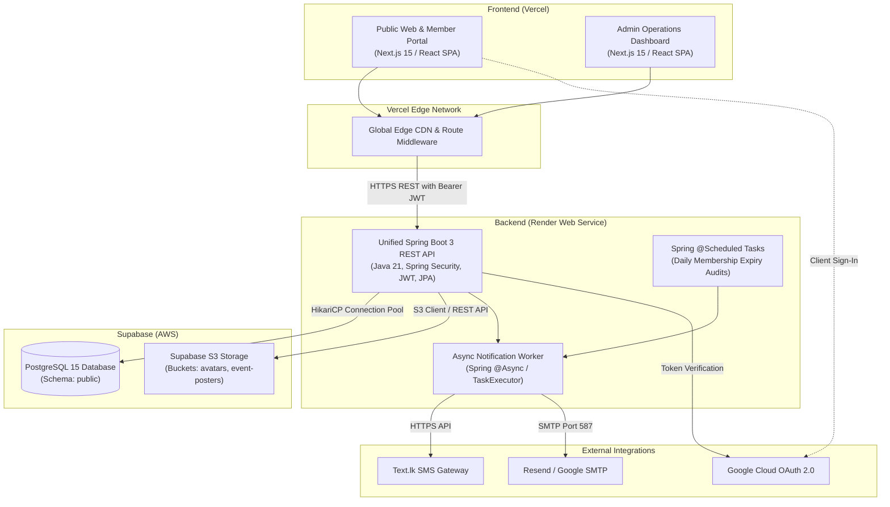
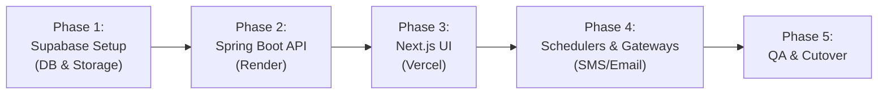

# Colombo Law Society (CLS) — Platform Modernization & Implementation Specification

> **Confidential & Proprietary Architecture Document**  
> **Target Deployment Architecture**: Frontend on **Vercel** | Backend on **Render** | Database & Storage on **Supabase**  
> **Status**: Comprehensive Codebase Audit & Implementation Blueprint (No Code Changes Applied Yet)

---

## Table of Contents
1. [Executive Summary & System Identity](#1-executive-summary--system-identity)
2. [Codebase Review & Functional Inventory](#2-codebase-review--functional-inventory)
   - [2.1 Member Web Application (`co_law_webapp`)](#21-member-web-application-co_law_webapp)
   - [2.2 Admin Web Application (`co_law_webapp_admin`)](#22-admin-web-application-co_law_webapp_admin)
   - [2.3 Spring Boot Transformation Project (`colombo-law-society`)](#23-spring-boot-transformation-project-colombo-law-society)
3. [Exhaustive Bug, Flaw & Security Audit](#3-exhaustive-bug-flaw--security-audit)
   - [3.1 Critical Security Vulnerabilities](#31-critical-security-vulnerabilities)
   - [3.2 Logic, Functional & Query Bugs](#32-logic-functional--query-bugs)
   - [3.3 Memory, Session & Resource Leaks](#33-memory-session--resource-leaks)
   - [3.4 Regressions in the Current Spring Boot Migration](#34-regressions-in-the-current-spring-boot-migration)
4. [Target System Architecture (Vercel + Render + Supabase)](#4-target-system-architecture-vercel--render--supabase)
5. [Complete Unified Database Schema (PostgreSQL for Supabase)](#5-complete-unified-database-schema-postgresql-for-supabase)
6. [Comprehensive REST API Specification](#6-comprehensive-rest-api-specification)
   - [6.1 Authentication & Registration](#61-authentication--registration)
   - [6.2 Member Portal Services](#62-member-portal-services)
   - [6.3 Public & Events Directory](#63-public--events-directory)
   - [6.4 Admin Operations & Management](#64-admin-operations--management)
   - [6.5 Notification & Broadcast Engine](#65-notification--broadcast-engine)
7. [Step-by-Step Migration & Implementation Roadmap](#7-step-by-step-migration--implementation-roadmap)
   - [Phase 1: Supabase Setup (Database & Storage)](#phase-1-supabase-setup-database--storage)
   - [Phase 2: Backend Unification (Spring Boot on Render)](#phase-2-backend-unification-spring-boot-on-render)
   - [Phase 3: Modern Frontend (Next.js on Vercel)](#phase-3-modern-frontend-nextjs-on-vercel)
   - [Phase 4: Schedulers, Email/SMS, & External Gateways](#phase-4-schedulers-emailsms--external-gateways)
   - [Phase 5: Quality Assurance, Verification & Cutover](#phase-5-quality-assurance-verification--cutover)
8. [Environment Variable Configuration Matrix](#8-environment-variable-configuration-matrix)

---

# 1. Executive Summary & System Identity

The **Colombo Law Society (CLS)** is the principal bar association representing legal professionals (attorneys-at-law, advocates, senior counsel) practicing in Colombo, Sri Lanka. The platform serves as the central hub for membership registration, regulatory credential verification (Supreme Court Enrolment Number, Bar Association Number), continuing professional development (CPD) and symposium/event booking, member communications (broadcast emails and SMS via Text.lk), and automated subscription renewal workflows.

### Existing Repositories Evaluated
1. **`C:\Users\dulan\...\co_law_webapp` (Legacy Member Webapp)**
   - *Architecture*: Java EE 7/8 (Servlets, JSP container, Hibernate 5/6, MySQL).
   - *UI*: Multi-page static HTML + jQuery/Vanilla JS AJAX calls to `@WebServlet` endpoints.
   - *Core Responsibilities*: Member self-registration, verification email dispatch, Google sign-in helper, member profile with avatar upload, event listing, event booking history.
2. **`C:\Users\dulan\...\co_law_webapp_admin` (Legacy Admin Webapp)**
   - *Architecture*: Java EE Servlets, Hibernate ORM, MySQL, EJB `@Stateless` schedulers.
   - *UI*: WowDash Bootstrap admin dashboard, AJAX endpoints.
   - *Core Responsibilities*: Admin authentication, user directory search & filter, membership status & tier upgrades, event CRUD, multi-channel broadcast messaging (Email + SMS), and automated renewal reminder schedules.
3. **`D:\IntelliJ-Projects\colombo-law-society` (Spring Boot Transformation Attempt)**
   - *Architecture*: Multi-module Maven setup (`common`, `admin`, `user`), Spring Boot 3.5.4, Spring Security 6, Spring Data JPA, Thymeleaf SSR.
   - *Status*: Significant structural improvements were made (e.g. `UserMembershipService` properly managing renewal history and preventing illegal downgrades). However, critical issues remain: dependency declaration scoping bugs in root `pom.xml`, plaintext password verification (`NoOpPasswordEncoder`), missing domain entities (`Event_Order`, `AreaOfExpertise`), SSR template routing crashes (`UserService` returning `model.toString()`), and unmigrated member endpoints.

---

# 2. Codebase Review & Functional Inventory

### 2.1 Member Web Application (`co_law_webapp`)

| Servlet / Component | URL Pattern | Function & Internal Logic |
| :--- | :--- | :--- |
| `SignUp.java` | `/signUp` | Parses JSON body with SC enrolment (`sc_en`), Bar Association enrolment (`ba_en`), names, NIC, email, mobile, gender, DOB, address, city, practice area, counsel expertise array, and password. Validates format. Generates a random 6-digit verification code. Saves `Address` and `User`. Defaults membership to `None` (Type ID 3). Sends verification email in a background Java `Thread`. Writes `email` to `HttpSession`. |
| `SignIn.java` | `/SignIn` | Looks up user by email and plaintext password. If `verification != 'Verified'`, saves user in session and returns `"Not Verified"`. If verified, saves `User_DTO` in session and returns success. |
| `VerifyEmail.java` | `/VerifyEmail` | Reads `email` from session and matches `verification` code. Sets `verification = 'Verified'`, removes session `email`. |
| `Newemailvcode.java` | `/Newemailvcode` | Regenerates a random verification code, updates the user, and re-dispatches the verification email. |
| `googleAuth.java` | `/googleAuth` | Reads `{ email, displayName }` from client JSON without token verification. If email matches a user, creates authenticated session. |
| `ForgotPassword.java` | `/ForgotPassword` | Finds user by email, sets random 6-digit code into `user.code`, and sends password reset email. |
| `ResetPassword.java` | `/ResetPassword` | Verifies reset code from session `email`, updates `user.password` in plaintext, removes session `email`. |
| `LoadIndexData.java` | `/LoadIndexData` | Fetches first 3 events where `start_date >= today`, formats dates (`dd MMM yyyy`), and returns list. |
| `LoadSignUpData.java` | `/LoadSignUpData` | Fetches lists of Genders, Cities, and Practice Areas for frontend dropdown population. |
| `LoadEvents.java` | `/LoadEvents` | Reads pagination `firstResult`, fetches up to 2 events per page, returns `eventCount` and `eventList`. |
| `LoadSingleEvent.java` | `/LoadSingleEvent` | Reads `eid` param, retrieves event by ID, and loads related events by category. |
| `LoadUserData.java` | `/LoadUserData` | Reads `user` from session, formats dates, loads registered upcoming events, loads booked events from `Event_Order` table, and extracts area of expertise list. |
| `UpdateUserData.java` | `/UpdateUserData` | Allows authenticated user to update mobile number and/or password with password complexity validation. |
| `ChangeAvatar.java` | `/ChangeAvatar` | Accepts multipart `image1`, saves file to local filesystem at `web/clients/{id}/avatar.jpg`. |
| `SignOut.java` | `/SignOut` | Calls `request.getSession().invalidate()`. |

---

### 2.2 Admin Web Application (`co_law_webapp_admin`)

| Servlet / Component | URL Pattern | Function & Internal Logic |
| :--- | :--- | :--- |
| `AdminSignIn.java` | `/AdminSignIn` | Validates admin username and password against table `admin`. Stores `AdminUser` in session. |
| `AdminUserDataLoad.java`| `/AdminUserDataLoad` | Returns all membership types (`User_Membership_Type`) and user statuses (`User_Status`). |
| `AdminSearchUser.java` | `/AdminSearchUser` | Multi-criteria search by keyword (email, mobile, NIC, name parts) and filter by membership type. Returns paginated (2 items/page) `Admin_User_DTO` list. |
| `AdminUpdateUser.java` | `/AdminUpdateUser` | Updates user status (Active/Inactive) and membership tier (Ordinary / Life / None). Sets dates, updates price (Ordinary = LKR 2,000, Life = LKR 5,000), dispatches email notification, and sends SMS via `model.SendSMS`. |
| `loadViewDetails.java` | `/loadViewDetails` | Loads membership types and top 2 recent broadcast messages from `BroadCastedMessages`. |
| `AddEvent.java` | `/AddEvent` | Multi-part form handler creating new event: parses date format `dd/MM/yyyy HH:mm`, validates future dates, saves poster to `web/event-image/{eventId}/image1.png`. |
| `UpdateEvent.java` | `/UpdateEvent` | Updates existing event attributes, poster, category, venue, and status. |
| `DeleteEvent.java` | `/DeleteEvent` | Removes event by ID from database. |
| `loadEventManagement.java`| `/loadEventManagement` | Retrieves all events, statuses, categories, and venues for admin dashboard. |
| `SendEmail.java` | `/SendEmail` | Queries members of a specified membership tier. Uses `ExecutorService` (10 threads) to send broadcast emails. Records entry in `BroadCastedMessages`. |
| `SendSMS.java` | `/SendSMS` | Queries members of a specified tier. Dispatches SMS via `model.SendSMS.send` (Text.lk API). Logs broadcast message. |
| `AutomaticEmail.java` | EJB `@Stateless` | Evaluates membership expiration dates daily: 30 days left -> monthly email; 7 days left -> weekly email; 1 day left -> urgent reminder. |
| `AutomaticSms.java` | EJB `@Stateless` | Automated SMS renewal reminders triggered on expiration thresholds. |

---

### 2.3 Spring Boot Transformation Project (`colombo-law-society`)

- **Module: `common`**
  - JPA Entities: `User`, `Admin`, `Event`, `Address`, `City`, `Gender`, `UserMembership`, `UserMembershipType`, `UserPractiseArea`, `UserStatus`, `BroadcastedMessages`, `EventCategory`, `EventStatus`, `EventVenue`.
  - Spring Data JPA Repositories: Clean repository interfaces extending `JpaRepository` with custom derived query methods.
- **Module: `admin`**
  - `AdminPageController`: Manages routes for login, dashboard, broadcast, event management, and member list.
  - `UserMembershipService`: **Major Architectural Improvement** — Properly records historical memberships. Implements business rules preventing downgrade of Life members, and stacking Ordinary renewals (+1 year from previous expiration).
  - `EventService`: Event creation, category creation, venue creation, status toggle, and poster saving.
  - `MailService`: Spring `JavaMailSender` implementation for HTML broadcast and confirmation emails.
- **Module: `user`**
  - `UserPageController`: Static Thymeleaf routing for member pages.
  - `UserDetailService`: Loads user by email for Spring Security `UserDetailsService`.

---

# 3. Exhaustive Bug, Flaw & Security Audit

### 3.1 Critical Security Vulnerabilities

1. **Plaintext Password Storage & Insecure PasswordEncoder**:
   - In both NetBeans web applications, passwords are stored and compared in plaintext without cryptographic hashing.
   - In the Spring Boot project, both `admin` and `user` `SecurityConfig.java` specify `NoOpPasswordEncoder.getInstance()`.
   - *Remediation*: Implement `BCryptPasswordEncoder(12)` across all user and admin authentication flows.
2. **Insecure Google OAuth Forgery (`googleAuth.java`)**:
   - The endpoint accepts raw email strings sent by client JavaScript without validating the cryptographic signature of the Google ID Token (JWT). Any actor can impersonate any user.
   - *Remediation*: Verify ID tokens on the backend using Google's official `GoogleIdTokenVerifier` or delegate directly to Supabase Auth.
3. **Hardcoded Secrets & API Keys Committed in Code**:
   - `model/SendSMS.java`: Contains live bearer token: `Bearer 246|EmUsVd5IT0gSxUSCpvUV8GUGr061V9TTNew968J245d6a230`.
   - `application.properties`: Contains hardcoded SMTP password `rwqv udqt wgnf hcje`.
   - *Remediation*: Extract all secrets into environment variables managed securely on Render/Vercel.
4. **Direct Entity Serialization Password Leak (`RegisterMember.java`, line 153)**:
   - Returning `ResponseEntity.ok(userRepository.save(user))` serializes the entity into JSON, transmitting the raw password in the HTTP response body to the client.
   - *Remediation*: Map entities to clean DTOs (`UserResponseDTO`) omitting sensitive attributes.
5. **No Password Reset Token Expiry or Invalidation**:
   - `ForgotPassword.java` and `ResetPassword.java` use an unhashed 6-digit integer without expiration timestamps or single-use invalidation flags.
   - *Remediation*: Implement cryptographically secure UUID tokens with a 15-minute expiration timestamp and immediate invalidation on reset.
6. **CSRF Disabled on Cookie-Based Sessions**:
   - Both Spring Boot sub-projects invoke `.csrf(csrf -> csrf.disable())`. When using browser cookies, this opens endpoints to Cross-Site Request Forgery.
   - *Remediation*: Adopt stateless Bearer JWT authentication for headless API clients.

---

### 3.2 Logic, Functional & Query Bugs

1. **Data Dropdown Bug in `LoadSignUpData.java` (Line 50)**:
   ```java
   Criteria criteria3 = session.createCriteria(UserPractiseArea.class);
   List<UserPractiseArea> userPractiseAreasList = criteria3.list();
   ...
   jsonObject.add("userPractiseAreasList", gson.toJsonTree(cityList)); // ⚠️ BUG: cityList passed instead!
   ```
   *Impact*: The practice area selector in the registration form was populated with city names.
2. **View Crash in `UserService.java` (Line 40)**:
   ```java
   return model.toString(); // ⚠️ BUG: Returns string "{userForm=...}" which crashes Thymeleaf resolver!
   ```
   *Impact*: Triggers a `TemplateInputException` on form submission.
3. **Admin Search User Status Mapping Error (`AdminSearchUser.java`, lines 137, 190)**:
   ```java
   admin_User_DTO.setStatus(String.valueOf(user.getUser_Membership().getId()));
   ```
   *Impact*: Sets user status to the *membership primary key ID* instead of `user.getUser_Status().getName()`.
4. **Filter Drop Collision in `AdminSearchUser.java`**:
   - If an admin searches by text AND selects a membership filter, the text query is completely ignored.
5. **500 Duplicate Rows Created per Broadcast in `SendSMS.java`**:
   - Inside the loop iterating through members, a new `BroadCastedMessages` row is persisted on every iteration. Sending an SMS to 500 members inserts 500 identical broadcast rows.
6. **Hardcoded Failure in `LoadIndexData.java` (Line 67)**:
   ```java
   response_DTO.setSuccess(false); // ⚠️ BUG: Overrides success to false even on valid data!
   ```
7. **Session Attribute Mismatch Between `SignIn` and `VerifyEmail`**:
   - `SignIn.java` sets session attribute `"user"` when not verified.
   - `VerifyEmail.java` checks session attribute `"email"`. Redirecting from sign-in causes verification to fail with a `NullPointerException`.
8. **Corrupted JSON Stream in `UpdateEvent.java`**:
   - Lines 250 and 264 write raw string data (`response.getWriter().write(...)`) followed by JSON, corrupting client response parsing.
9. **Form Parameter Typo in `AddEvent.java`**:
   - Parameter named `vent_category` instead of `event_category`, and returns the message `"New Product Added"` (copied from an e-commerce template).
10. **GET Request Reading Request Body in `LoadEvents.java`**:
    - Calls `req.getReader()` during HTTP GET, which fails or throws errors on modern HTTP proxies.

---

### 3.3 Memory, Session & Resource Leaks

1. **Systematic Hibernate Connection Leaks**:
   - Throughout `LoadEvents`, `LoadSingleEvent`, `LoadSignUpData`, `googleAuth`, `AdminSearchUser`, and `UpdateUserData`, `session.close()` is never called in error paths or early returns, exhausting connection pools.
2. **Full-Table Ingestion for Pagination Counts**:
   - Servlets call `criteria.list().size()` to get total row counts, loading every row into server memory rather than executing a SQL `COUNT(*)` query.
3. **Synchronous Mass Mailing Causing Gateway Timeouts**:
   - In `SendBroadcastEmailToMembers.java`, emails are sent synchronously in a single request thread, causing HTTP gateway timeouts on cloud proxies (Render has a 100s timeout).
4. **Ephemeral Local Storage Loss**:
   - Images written to `web/clients/...` or `common/uploads/...` are lost on every cloud redeployment or dyno restart. Files must be stored in cloud object storage (Supabase Storage).

---

### 3.4 Regressions in the Current Spring Boot Migration

1. **Root `pom.xml` Dependency Management Issue**:
   - Dependencies were placed inside `<dependencyManagement>` instead of `<dependencies>`, preventing child modules from inheriting dependencies unless explicitly declared.
2. **Missing Domain Models**:
   - `Event_Order`, `Event_Order_Status`, and the many-to-many relationship `user_has_area_of_expertise` were not ported from legacy NetBeans to Spring Boot `common`.
3. **Fragmented Ports & Module Layout**:
   - Running `admin` on port 8080 and `user` on port 8081 creates unnecessary complexity and hosting costs. Merging into a single unified REST API service simplifies deployment on Render.

---

# 4. Target System Architecture (Vercel + Render + Supabase)



---

# 5. Complete Unified Database Schema (PostgreSQL for Supabase)

Below is the production PostgreSQL DDL for Supabase:

```sql
-- Enable Extensions
CREATE EXTENSION IF NOT EXISTS "uuid-ossp";
CREATE EXTENSION IF NOT EXISTS "pgcrypto";

-- =====================================================
-- 1. LOOKUP TABLES
-- =====================================================
CREATE TABLE genders (
    id SERIAL PRIMARY KEY,
    name VARCHAR(20) NOT NULL UNIQUE
);

INSERT INTO genders (id, name) VALUES (1, 'Male'), (2, 'Female') ON CONFLICT DO NOTHING;

CREATE TABLE cities (
    id SERIAL PRIMARY KEY,
    name VARCHAR(100) NOT NULL UNIQUE
);

CREATE TABLE user_statuses (
    id SERIAL PRIMARY KEY,
    name VARCHAR(20) NOT NULL UNIQUE
);

INSERT INTO user_statuses (id, name) VALUES (1, 'Active'), (2, 'Inactive'), (3, 'Suspended') ON CONFLICT DO NOTHING;

CREATE TABLE user_membership_types (
    id SERIAL PRIMARY KEY,
    name VARCHAR(50) NOT NULL UNIQUE,
    price NUMERIC(10, 2) NOT NULL DEFAULT 0.00,
    validity_years INT NOT NULL DEFAULT 1
);

INSERT INTO user_membership_types (id, name, price, validity_years) VALUES 
(1, 'Ordinary Member', 2000.00, 1),
(2, 'Life Member', 5000.00, 99),
(3, 'None', 0.00, 0)
ON CONFLICT DO NOTHING;

CREATE TABLE user_practise_areas (
    id SERIAL PRIMARY KEY,
    name VARCHAR(100) NOT NULL UNIQUE
);

CREATE TABLE area_of_expertise (
    id SERIAL PRIMARY KEY,
    name VARCHAR(100) NOT NULL UNIQUE
);

CREATE TABLE event_statuses (
    id SERIAL PRIMARY KEY,
    name VARCHAR(30) NOT NULL UNIQUE
);

INSERT INTO event_statuses (id, name) VALUES (1, 'Upcoming'), (2, 'Ongoing'), (3, 'Completed'), (4, 'Cancelled') ON CONFLICT DO NOTHING;

CREATE TABLE event_categories (
    id SERIAL PRIMARY KEY,
    name VARCHAR(100) NOT NULL UNIQUE
);

CREATE TABLE event_venues (
    id SERIAL PRIMARY KEY,
    name VARCHAR(150) NOT NULL,
    address TEXT NOT NULL
);

CREATE TABLE event_order_statuses (
    id SERIAL PRIMARY KEY,
    name VARCHAR(30) NOT NULL UNIQUE
);

INSERT INTO event_order_statuses (id, name) VALUES (1, 'Pending'), (2, 'Confirmed'), (3, 'Cancelled') ON CONFLICT DO NOTHING;

-- =====================================================
-- 2. CORE ADMINISTRATIVE & USER ENTITIES
-- =====================================================
CREATE TABLE admins (
    id SERIAL PRIMARY KEY,
    user_name VARCHAR(50) NOT NULL UNIQUE,
    password_hash VARCHAR(255) NOT NULL,
    full_name VARCHAR(100),
    email VARCHAR(100),
    created_at TIMESTAMPTZ DEFAULT NOW()
);

CREATE TABLE addresses (
    id SERIAL PRIMARY KEY,
    address_line1 VARCHAR(255) NOT NULL,
    address_line2 VARCHAR(255),
    city_id INT NOT NULL REFERENCES cities(id) ON DELETE RESTRICT
);

CREATE TABLE users (
    id SERIAL PRIMARY KEY,
    en_id VARCHAR(50),
    first_name VARCHAR(100) NOT NULL,
    last_name VARCHAR(100) NOT NULL,
    mobile VARCHAR(25) NOT NULL UNIQUE,
    email VARCHAR(100) NOT NULL UNIQUE,
    password_hash VARCHAR(255) NOT NULL,
    gender_id INT REFERENCES genders(id),
    address_id INT REFERENCES addresses(id),
    dob DATE NOT NULL,
    registered_date TIMESTAMPTZ DEFAULT NOW(),
    nic VARCHAR(20) NOT NULL UNIQUE,
    sc_en VARCHAR(50) NOT NULL, -- Supreme Court Enrolment Number
    ba_en VARCHAR(50) NOT NULL, -- Bar Association Enrolment Number
    avatar_url TEXT,
    user_practise_area_id INT REFERENCES user_practise_areas(id),
    user_status_id INT NOT NULL DEFAULT 1 REFERENCES user_statuses(id),
    is_verified BOOLEAN NOT NULL DEFAULT FALSE,
    verification_code VARCHAR(10),
    reset_token VARCHAR(100),
    reset_token_expiry TIMESTAMPTZ
);

CREATE TABLE user_has_area_of_expertise (
    user_id INT NOT NULL REFERENCES users(id) ON DELETE CASCADE,
    area_of_expertise_id INT NOT NULL REFERENCES area_of_expertise(id) ON DELETE CASCADE,
    PRIMARY KEY (user_id, area_of_expertise_id)
);

CREATE TABLE user_memberships (
    id SERIAL PRIMARY KEY,
    user_id INT NOT NULL REFERENCES users(id) ON DELETE CASCADE,
    user_membership_type_id INT NOT NULL REFERENCES user_membership_types(id),
    start_date TIMESTAMPTZ NOT NULL,
    end_date TIMESTAMPTZ NOT NULL,
    price NUMERIC(10, 2) NOT NULL DEFAULT 0.00,
    created_at TIMESTAMPTZ DEFAULT NOW()
);

CREATE INDEX idx_user_memberships_dates ON user_memberships(user_id, end_date DESC);

-- =====================================================
-- 3. EVENTS & BOOKINGS
-- =====================================================
CREATE TABLE events (
    id SERIAL PRIMARY KEY,
    name VARCHAR(255) NOT NULL,
    description TEXT NOT NULL,
    start_date_time TIMESTAMPTZ NOT NULL,
    end_date_time TIMESTAMPTZ NOT NULL,
    location VARCHAR(255) NOT NULL,
    price NUMERIC(10, 2) NOT NULL DEFAULT 0.00,
    poster_url TEXT,
    event_status_id INT NOT NULL REFERENCES event_statuses(id),
    event_category_id INT NOT NULL REFERENCES event_categories(id),
    event_venue_id INT NOT NULL REFERENCES event_venues(id),
    admin_id INT REFERENCES admins(id),
    created_at TIMESTAMPTZ DEFAULT NOW()
);

CREATE TABLE event_orders (
    id SERIAL PRIMARY KEY,
    created_at TIMESTAMPTZ DEFAULT NOW(),
    user_id INT NOT NULL REFERENCES users(id) ON DELETE CASCADE,
    event_id INT NOT NULL REFERENCES events(id) ON DELETE CASCADE,
    event_order_status_id INT NOT NULL REFERENCES event_order_statuses(id),
    amount_paid NUMERIC(10, 2) NOT NULL DEFAULT 0.00
);

-- =====================================================
-- 4. BROADCAST AUDIT LOG
-- =====================================================
CREATE TABLE broadcasted_messages (
    id SERIAL PRIMARY KEY,
    title VARCHAR(255) NOT NULL,
    content TEXT NOT NULL,
    channel VARCHAR(20) NOT NULL DEFAULT 'EMAIL', -- EMAIL, SMS, BOTH
    user_membership_type_id INT NOT NULL REFERENCES user_membership_types(id),
    recipients_count INT NOT NULL DEFAULT 0,
    sent_at TIMESTAMPTZ DEFAULT NOW()
);
```

---

# 6. Comprehensive REST API Specification

### Base URL: `https://cls-api.onrender.com/api/v1`

### 6.1 Authentication & Registration
- `POST /auth/signup`
  - **Body**: `{ "sc_en": "SC/123", "ba_en": "BA/456", "first_name": "John", "last_name": "Doe", "nic": "199012345678", "email": "john@example.com", "mobile": "0771234567", "gender_id": 1, "dob": "1990-05-15", "address_line1": "No 12", "address_line2": "Flower Rd", "city_id": 3, "practice_area_id": 2, "expertise_ids": [1, 4], "password": "Password123!" }`
  - **Response**: `{ "success": true, "message": "Verification code sent to email." }`
- `POST /auth/verify-email`
  - **Body**: `{ "email": "john@example.com", "code": "654321" }`
  - **Response**: `{ "success": true, "message": "Email verified successfully." }`
- `POST /auth/resend-code`
  - **Body**: `{ "email": "john@example.com" }`
- `POST /auth/login`
  - **Body**: `{ "email": "john@example.com", "password": "Password123!" }`
  - **Response**: `{ "success": true, "data": { "accessToken": "jwt...", "refreshToken": "jwt...", "user": { "id": 1, "name": "John Doe", "email": "..." } } }`
- `POST /auth/google`
  - **Body**: `{ "idToken": "google-jwt-token" }`
  - **Response**: Authenticates or links Google account and returns JWT tokens.
- `POST /auth/forgot-password`
  - **Body**: `{ "email": "john@example.com" }`
- `POST /auth/reset-password`
  - **Body**: `{ "token": "uuid-token", "newPassword": "NewPassword123!" }`

### 6.2 Member Portal Services (`ROLE_MEMBER`)
- `GET /member/profile`
  - Returns authenticated user details, address, active membership status, practice area, and areas of expertise.
- `PUT /member/profile`
  - Updates contact information (mobile, address).
- `POST /member/avatar` (Multipart)
  - Uploads user profile image to Supabase Storage bucket `avatars` and updates `avatar_url`.
- `PUT /member/password`
  - Changes password (requires `currentPassword` and `newPassword`).
- `GET /member/events`
  - Returns member's event booking history (`event_orders`).
- `POST /member/events/{id}/book`
  - Registers the user for an event and creates an `event_orders` record.

### 6.3 Public & Events Directory
- `GET /public/lookup-data`
  - Returns metadata arrays: `{ genders, cities, practiceAreas, expertiseAreas }`.
- `GET /public/events?page=0&size=10&categoryId=1`
  - Paginated list of upcoming events with category and search filter.
- `GET /public/events/{id}`
  - Returns single event details and related events.

### 6.4 Admin Operations & Management (`ROLE_ADMIN`)
- `POST /admin/auth/login`
  - Admin login returning Admin JWT.
- `GET /admin/members?page=0&size=20&keyword=...&membershipTypeId=...&statusId=...`
  - Paginated member search with server-side `COUNT(*)` projection.
- `GET /admin/members/{id}`
  - Full details for a single member, including membership history and bookings.
- `PUT /admin/members/{id}/status`
  - Body: `{ "statusId": 1 }` (Active, Inactive, Suspended).
- `POST /admin/members/{id}/membership`
  - Body: `{ "membershipTypeId": 1 }` (Ordinary / Life).
  - Calculates renewal dates: Ordinary extends by +1 year from active expiration; Life sets 99-year validity. Rejects invalid downgrades.
- `POST /admin/events` (Multipart)
  - Creates an event, uploads poster to Supabase Storage `event-posters`, and records event details.
- `PUT /admin/events/{id}`
  - Updates event details, venue, category, or status.
- `DELETE /admin/events/{id}`
  - Deletes event (with validation to prevent deleting events with confirmed bookings).

### 6.5 Notification & Broadcast Engine (`ROLE_ADMIN`)
- `POST /admin/broadcast/email`
  - Body: `{ "membershipTypeId": 1, "title": "Notice", "message": "HTML/Text content" }`
  - Asynchronously dispatches emails via thread pool and logs a single row in `broadcasted_messages`.
- `POST /admin/broadcast/sms`
  - Body: `{ "membershipTypeId": 1, "title": "Notice", "message": "Text content" }`
  - Asynchronously dispatches SMS messages via Text.lk API to `+94` phone numbers and logs a single row in `broadcasted_messages`.
- `GET /admin/broadcast/history`
  - Returns paginated broadcast logs.

---

# 7. Step-by-Step Migration & Implementation Roadmap



### Phase 1: Supabase Setup (Database & Storage)
1. Provision a free/pro project on [Supabase](https://supabase.com).
2. Execute the PostgreSQL DDL script in the Supabase SQL Editor.
3. In Supabase Storage, create two public buckets:
   - `avatars` (Public read, max size 5MB)
   - `event-posters` (Public read, max size 10MB)
4. Verify connection string via pooled port 5432 / 6543.

### Phase 2: Backend Unification (Spring Boot on Render)
1. **Maven Restructuring**:
   - Merge `admin`, `user`, and `common` into a unified `cls-api` application.
   - Move all dependencies from `<dependencyManagement>` into `<dependencies>`.
   - Update `pom.xml` with:
     - `spring-boot-starter-data-jpa`
     - `spring-boot-starter-security`
     - `spring-boot-starter-web`
     - `spring-boot-starter-validation`
     - `org.postgresql:postgresql`
     - `io.jsonwebtoken:jjwt-api:0.12.5`
     - `software.amazon.awssdk:s3` (for Supabase S3-compatible storage) or Supabase Java SDK.
2. **Security & Cryptography**:
   - Configure `BCryptPasswordEncoder` bean.
   - Implement `JwtAuthenticationFilter` reading `Authorization: Bearer <token>`.
   - Implement role-based endpoint authorization (`ROLE_MEMBER`, `ROLE_ADMIN`).
3. **Data Access & DTO Mapping**:
   - Port all JPA entities to PostgreSQL dialects.
   - Add missing `EventOrder`, `EventOrderStatus`, and `AreaOfExpertise` entities.
   - Replace raw entity HTTP returns with secure DTOs.
4. **Deploy to Render**:
   - Connect repository to Render as a Web Service.
   - Configure build: `./mvnw clean package -DskipTests`.
   - Configure start command: `java -Dspring.profiles.active=prod -jar target/cls-api-0.0.1.jar`.

### Phase 3: Modern Frontend (Next.js on Vercel)
1. **Initialize Project**:
   - Create Next.js 15 App Router project with TypeScript, Tailwind CSS, and Lucide icons.
2. **Implement Route Hierarchy**:
   - `app/(public)`: Landing page, committee/team, services, event catalog, single event view.
   - `app/(auth)`: Sign-up wizard, email verification, login, password reset.
   - `app/(member)`: Dashboard, profile editor, CPD/events history, membership badge.
   - `app/(admin)`: Admin dashboard, member directory (search, filters, status toggles), event manager, broadcast console.
3. **API Client & State**:
   - Configure Axios / Fetch client with JWT interceptors and automatic token refresh.
4. **Deploy to Vercel**:
   - Link repository to Vercel and configure production environment variables.

### Phase 4: Schedulers, Email/SMS & Gateways
1. **Spring Asynchronous Task Engine**:
   - Enable `@EnableAsync` and configure `ThreadPoolTaskExecutor` (core 10, max 50).
2. **Notification Dispatchers**:
   - Build `SmsService` consuming Text.lk API using Spring `RestClient` or `WebClient`.
   - Build `MailService` using Spring `JavaMailSender` with responsive HTML templates.
3. **Membership Expiry Scheduler**:
   - Enable `@EnableScheduling` with `@Scheduled(cron = "0 0 8 * * ?", zone = "Asia/Colombo")`.
   - Query memberships expiring in 30 days, 7 days, and 1 day, dispatching renewal alerts asynchronously.

### Phase 5: Quality Assurance, Verification & Cutover
1. Validate end-to-end user journeys (registration -> email verification -> sign-in -> profile update -> event booking).
2. Validate admin workflows (member search -> status toggle -> membership renewal -> event publication -> broadcast SMS/email).
3. Conduct security testing (verify passwords are encrypted, tokens expire properly, and unauthorized requests return 401/403).

---

# 8. Environment Variable Configuration Matrix

### Backend (`cls-api` on Render)
| Variable | Example Value | Description |
| :--- | :--- | :--- |
| `SPRING_PROFILES_ACTIVE` | `prod` | Activates production profile |
| `DATABASE_URL` | `jdbc:postgresql://db.xxx.supabase.co:5432/postgres` | Supabase JDBC Connection URL |
| `DATABASE_USER` | `postgres` | Supabase database user |
| `DATABASE_PASSWORD` | `[Secure-Password]` | Supabase database password |
| `JWT_SECRET` | `[256-bit-base64-key]` | Secret key for signing JWTs |
| `JWT_EXPIRATION_MS` | `900000` | 15 minutes in milliseconds |
| `JWT_REFRESH_EXPIRATION_MS`| `604800000` | 7 days in milliseconds |
| `CORS_ALLOWED_ORIGINS` | `https://colombolawsociety.vercel.app` | Vercel frontend URL |
| `SUPABASE_URL` | `https://[ref].supabase.co` | Supabase project API URL |
| `SUPABASE_SERVICE_ROLE_KEY`| `[Supabase-Service-Role-Key]` | For storage file operations |
| `TEXTLK_API_TOKEN` | `[TextLK-Bearer-Token]` | Text.lk SMS API token |
| `TEXTLK_SENDER_ID` | `CLS` or `TextLKDemo` | Registered SMS Sender ID |
| `SMTP_HOST` | `smtp.gmail.com` | Mail provider host |
| `SMTP_PORT` | `587` | TLS port |
| `SMTP_USERNAME` | `notifications@colombolawsociety.com` | SMTP username |
| `SMTP_PASSWORD` | `[App-Specific-Password]` | SMTP app password |

### Frontend (Next.js on Vercel)
| Variable | Example Value | Description |
| :--- | :--- | :--- |
| `NEXT_PUBLIC_API_URL` | `https://cls-api.onrender.com/api/v1` | Render backend API base URL |
| `NEXT_PUBLIC_SUPABASE_URL` | `https://[ref].supabase.co` | Supabase URL for public media CDN |
| `NEXT_PUBLIC_GOOGLE_CLIENT_ID`| `[Google-OAuth-Client-ID]` | Google OAuth client credential |
